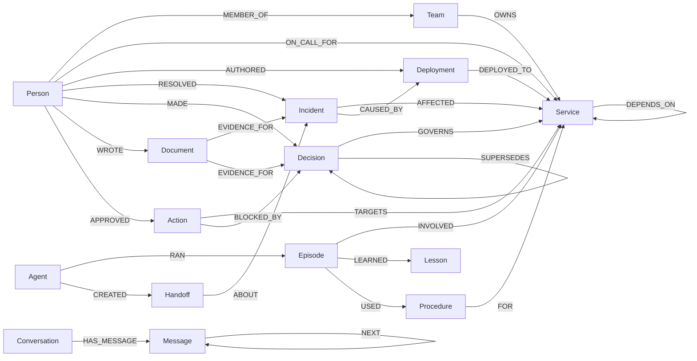
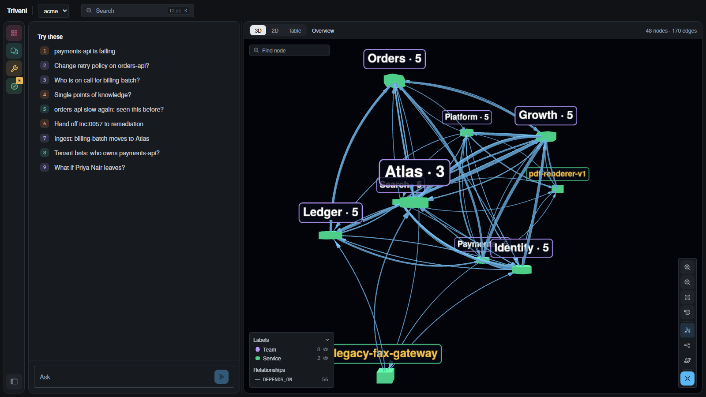
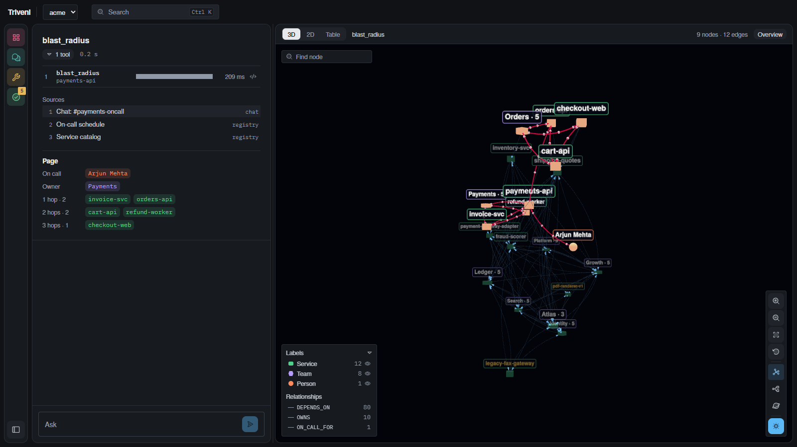

# Triveni

**त्रिवेणी, "the confluence of three."** An engineering Company Brain on [FalkorDB](https://www.falkordb.com/) where agents **act** on connected data, **remember and coordinate** through the graph, and **prove every answer with a path**.

Built for **Graph Hacks: Context for AI Agents** (WeMakeDevs × FalkorDB). Tracks entered:
- Track 01: Agents That Act on Connected Data
- Track 02: Agent Memory and Coordination
- Track 03: Company Brain

All code was written during the event window (Oct 15–18, 2026).

## Why a graph
Incident questions are about connections: what depends on this service, who owns it, what changed, which decision constrains us, who fixed this before. Each one is a traversal, and none is a text lookup. Every Triveni answer includes the Cypher it ran, the path it found, and the source documents behind it.

## Interface
One screen, laid out after tools engineers already use (FalkorDB Browser, Perplexity, incident.io, Langfuse, Neo4j Bloom, Backstage).
- **Thread** (left): every answer shows a verdict from the deterministic proof check, its tool calls as a timeline (each bar placed when the agent called the tool, as long as the call took), its source documents as cards, the answer with every cited id as a clickable chip, and the tool result as structured fields (who to page, decision chain, recalled episode, what changed, action awaiting approval).
- **Graph** (centre): the overview groups services inside their owning team, with unowned services in a dashed "No owner" box; double-click a team to fold it. Answers show their evidence subgraph (Force / Tree / Radial layouts, label and relationship filters, search, Dim, Graph | Table views). Double-click any node, or use +1 hop / +2 hops, to grow the canvas from it. An ingest that ended a fact gets a Before | After | Both toggle.
- **Right panel**: an entity page per node (owner, on call, team, then edges grouped by what they reach, each with its source document, and ended facts under History), the Cypher and parameters of each step, the source document, and the approvals inbox.
- **Ctrl/Cmd+K** opens a command palette over scenarios, actions, conversations, tools and every node. Panes can be resized or the thread hidden.

## Setup
```bash
docker compose up -d falkordb                      # or use FalkorDB Cloud, see .env.example
python -m venv .venv && . .venv/bin/activate       # Windows: .venv\Scripts\activate
pip install -e ".[dev]"
cp .env.example .env
python -m backend.scripts.demo_reset                # seeds acme + beta, replays cached ingestion (no model key needed)
pytest -q
uvicorn backend.app.main:app --port 8000          # API on :8000 (on Windows, avoid --reload)
npm --prefix frontend install && npm --prefix frontend run dev   # UI on :3001
python -m backend.app.agents.triage "payments-api is failing, what's affected and who do I page?" --tenant acme
```

## Deploy
FalkorDB Cloud holds all data; Render runs the API (code only); Vercel serves the UI.
1. **API on Render:** New -> Blueprint -> this repo. `render.yaml` sets the build (`pip install -e .`), the start command, Python 3.13 and the health check. Paste the FalkorDB Cloud host, port, username and password and the Groq/Gemini keys when asked. Seed once from your machine with `python -m backend.scripts.demo_reset` against the same FalkorDB instance.
2. **UI on Vercel:** import this repo with Root Directory `frontend` and set `NEXT_PUBLIC_TRIVENI_API` to the Render URL (for example `https://triveni-api.onrender.com`).
3. CORS: `TRIVENI_CORS_ORIGIN_REGEX` in `render.yaml` already allows every `triveni*.vercel.app` URL.

The free Render plan sleeps after 15 minutes idle: the first request after that takes about a minute.

## Graph model
One FalkorDB graph per tenant (`tenant_acme`, `tenant_beta`): a tenant is selected per request and no query can cross graphs. The schema is fixed and enforced in code (`backend/app/graph/schema.py`): seed and ingestion validate every node and edge before writing. Full rationale: [notes/graph-model.md](notes/graph-model.md). Demo tenant `acme`: about 360 nodes and 1,500 edges.



**The live graph** (screenshots of the app on the seeded `acme` tenant, read from FalkorDB)



*Overview.* Each team is one node with its service count; lines are the `DEPENDS_ON` edges between their services. Unowned services (`pdf-renderer-v1`, `legacy-fax-gateway`) stand alone. Click a team to open it, click any node to load its neighbours.



*An answer.* `blast_radius` on `payments-api`: the services that depend on it within 3 hops, its owner and the on-call engineer light up inside the full map, built only from the tool's returned path.

**Nodes**

| Group | Labels (key properties) |
|---|---|
| Org | `Person {id, name, role}`, `Team {id, name}`, `Service {id, name, tier, lang}` |
| Change and ops | `Deployment {id, version, ts, status}`, `Incident {id, title, severity, ts_open, ts_close, summary}` |
| Knowledge | `Decision {id, title, ts, status, rationale, forbids[]}`, `Document {id, title, kind, text, ts, source}`; kind is runbook, postmortem, adr, ticket, chat or registry |
| Agents and memory | `Agent`, `Conversation`, `Message {seq}`, `Episode {question, outcome}`, `Lesson {confidence, last_reinforced}`, `Procedure {steps, success_count, fail_count}` |
| Coordination and actions | `Handoff {status: open, claimed, done; claimed_by}`, `Action {kind, status: proposed, approved, rejected, blocked, executed}` |

Ids are stable and prefixed (`svc:payments-api`, `per:priya-nair`, `inc:0042`, `adr:019`). Times are ISO-8601 UTC strings. Maps are stored as JSON strings, because FalkorDB properties cannot hold maps.

**Edges, in four categories**

| Category | Types | Properties | Why |
|---|---|---|---|
| State (can change) | `MEMBER_OF`, `OWNS`, `ON_CALL_FOR`, `DEPENDS_ON` | `valid_from`, `valid_to` (absent = current), `source_doc`, `ended_by` | A contradicting document ends the old edge and adds a new one; history is never deleted. Read tools filter `valid_to IS NULL` |
| Event (immutable) | `AUTHORED`, `DEPLOYED_TO`, `AFFECTED`, `CAUSED_BY`, `RESOLVED`, `MADE`, `GOVERNS`, `SUPERSEDES`, `EVIDENCE_FOR`, `MENTIONS`, `WROTE` | `source_doc` | Every fact names the document it came from |
| System (written by agents) | `HAS_MESSAGE`, `NEXT`, `WITH`, `RAN`, `INVOLVED`, `LEARNED`, `USED`, `FOR`, `CREATED`, `TO`, `ABOUT`, `TARGETS`, `PROPOSED_IN`, `APPROVED`, `BLOCKED_BY` | timestamps | Memory, coordination and actions live in the same graph as the facts they are about |
| Derived (rebuilt) | `KNOWS {weight}`, `KNOWN_BY`, `RESPONSIBLE_FOR` | `derived: true` | Algorithm procedures cannot filter on `valid_to`, so PageRank, betweenness and WCC run on projections rebuilt from current facts after every seed and ingest |

## How the graph shapes what the agents do
The graph is the agents' context layer, not a store they occasionally read. Remove FalkorDB and nothing below has an answer path: every tool, memory read, handoff and action check is a Cypher query against the tenant graph.

| Decision the agent makes | What decides it in the graph |
|---|---|
| Which entity a question is about | Names are resolved against the graph's own nodes before any tool runs; an unknown name stops the tool and returns suggestions (`graph/resolve.py`) |
| Which tools run (no model) | The rules planner spots services, people, teams, incidents and decisions in the question from the graph and picks tools by entity type |
| What it says | Every answer is checked by code against the graph and this run's tool results; an answer naming anything else is replaced by the tool results (`agents/verify.py`) |
| Whether an action may be proposed | A current `Decision` that `GOVERNS` the target and `forbids` the action blocks it, recorded with a `BLOCKED_BY` edge |
| Who to page and what breaks | Variable-length `DEPENDS_ON` traversal plus current `OWNS` and `ON_CALL_FOR` edges |
| What it remembers | `Episode` nodes reached through shared `Service`, `Incident` and `Person` neighbours; procedures carry success and failure counts; lessons decay with age |
| What the second agent works on | Only `Handoff` nodes: the remediation agent claims one atomically (`open` to `claimed` in one statement) and has no other channel |
| What changed and who must hear | An ingested document that ends a `State` edge triggers a change-impact report and an approval-gated `notify_owner` |
| Which data it can see | The tenant picks the graph; tools never receive a tenant argument |

### How deep the graph work goes
Every read tool answers with a traversal or an algorithm, never a single lookup. Measured from the Cypher each one runs.

| Kind of graph work | Tools | What only a graph gives |
|---|---|---|
| Variable-length traversal (2–4 hops, current edges only) | `blast_radius`, `shortest_path`, `recent` (each deploy's reach), `find_services` (transitive dependents), `owner_of` (owners and on-call of what a service needs, 2 hops upstream), `why_not` (nearest on-call within 2 hops), `describe` (each entity's reach), `team_services` (other teams depending on it) | A routine email-sender deploy reaches 35 services within 3 hops, while payments-api 2.14.0 reaches 5; 17 services of 7 other teams depend on Team Ledger; nobody is on call for pdf-renderer-v1, but the graph names the nearest people who are |
| Graph algorithms | `critical_services` (PageRank), `key_people` (betweenness), `find_orphans` (WCC), `what_if` (`GRAPH.COPY`, then algorithms rerun on the copy) | Global structure: who bridges teams, what is central, what nobody is responsible for |
| Neighbourhood reasoning over derived edges | `recall` (episodes through shared entities), `similar_incidents`, `who_knows` and `owner_of` escalation (KNOWS, built from deploys, resolved incidents, decisions and docs), `decision_trail` (SUPERSEDES chains) | Memory found by structure rather than text; expertise derived from what people actually did |

## Track 01: Act on connected data
| Key focus | Feature |
|---|---|
| What-if simulation | `what_if`: "what if Priya leaves / Team Ledger is dissolved / pdf-renderer-v1 is decommissioned": the graph is cloned with FalkorDB `GRAPH.COPY`, the change is applied to the clone, algorithms rerun, and the diff is returned (knowledge lost, new single points of knowledge, new orphans, dependents) |
| Questions no fixed tool covers | `find_services` (deterministic filters: tier, language, owning team, missing owner or on-call, e.g. "which tier-1 services have nobody on call?", works without a model). As a last resort, `graph_query` lets the model write one **read-only** Cypher query: it runs through FalkorDB's `GRAPH.RO_QUERY` (writes rejected by the server), labels and relationship types are checked against the schema, and so is the direction of every hop (a backwards `CAUSED_BY` is refused, not run); `count(x)` becomes `count(DISTINCT x)` and `LIMIT 1` rankings become `LIMIT 5` so ties show (both reported); results are capped at 50 rows with a 3 s timeout; the query is shown, and the answer carries a "model-written query" caveat |
| Graph-first planning | When the deterministic planner recognises a question (entities found in the graph plus a clear intent), its read-only tools run over MCP before any model is called, and the model starts from the graph's answer. This usually means one model round instead of several, which keeps answers inside free-tier token-per-minute limits |
| What changed, and who did it | `recent`: newest deployments (author, incidents caused), incidents, decisions and actions (who approved, what blocked them), optionally for one service, for questions that name no entity, e.g. "who approved the most recent change?" |
| Multi-hop reasoning | `blast_radius` (variable-length DEPENDS_ON, current edges only, with owners and on-call), `shortest_path` (dependency chains or any fact path, e.g. person → incident → service → service), `decision_trail` (SUPERSEDES chains) |
| Graph queries and algorithms as agent tools | `critical_services` (`algo.pageRank` on DEPENDS_ON), `key_people` (`algo.betweenness` on the derived expertise graph: single points of knowledge), `find_orphans` (`algo.WCC` on the derived responsibility graph), all exposed over MCP and checked against independently computed ground truth |
| Tool selection through MCP | `backend/app/mcp_server.py` exposes the whole registry over MCP, one server per tenant (the tenant is never a tool argument). The triage agent (`agents/triage.py`) lists tools over MCP and calls them over MCP; every step is logged with tool, input, the model's progress note (why) and timing |
| Actions based on what the graph shows | `propose_action` → Action node; blocked with a BLOCKED_BY edge when a current governing Decision forbids it (e.g. `change_retry_policy` on orders-api blocked by ADR-019); otherwise a person approves or rejects in the UI and approved actions go to a simulated outbox |
| Explainable results | Every MCP tool result carries `cypher`, `params`, `paths`, `sources`, `tracks` as structuredContent, plus an explicit `outcome` (answered / from memory / not in graph / unknown entity) so an empty traversal never reads as "nothing is affected"; the agent cites entity ids and source documents; a **deterministic proof check** (code, not a model) checks every entity the answer names, by id or by plain name, against the graph and this run's tool results, and catches invented services and people. **An answer that names anything a tool did not return is rejected and replaced by the tool results** (the draft stays inspectable) |
| Deterministic guardrails | Every entity argument is resolved against the graph before a tool runs (`graph/resolve.py`): "Payments API", "Team Ledger", "incident 42", "ADR 19" and a unique "Priya" resolve; near-misses like "paymnts-api" are refused with suggestions, never guessed; ambiguous names are refused with candidates. With no model reachable, a rules planner spots entities in the question from the graph itself and picks tools deterministically (27/27 test phrasings), so the product keeps answering on free-tier outages |

## Track 02: Remember & coordinate
| Key focus | Feature |
|---|---|
| Episodic, semantic, procedural memory | `remember` writes Episode (INVOLVED entities, RAN by the agent), Lesson (reinforced, not duplicated) and Procedure (success/fail counters); `recall` finds past episodes **through shared graph entities**: a new payments-api incident reaches last month's episode via `svc:payments-api`. Memory decays: lesson confidence halves every 90 days since last reinforced (computed on read, nothing deleted), and a failed procedure weakens the lessons learned with it |
| Persistent conversation history | Conversation -HAS_MESSAGE-> Message chained by NEXT; every request rebuilds the model's context from the graph (no in-process state, tested with a real process restart); the UI reopens any conversation |
| Shared state and handoffs | Triage and Remediation run as separate agents with separate MCP servers and share only graph state: Handoff nodes (open → claimed → done) with an atomic single-statement claim (8 concurrent claimers → 1 winner, tested) |
| High-concurrency reads and writes | `python -m backend.app.coordination.concurrency`: 16 agents on two tenants at once, 400 remember/recall/handoff/history operations in 5.3 s, p95 < 115 ms per operation to FalkorDB Cloud, 0 cross-tenant reads, 0 double claims, 0 duplicate message seq ([docs/concurrency.md](docs/concurrency.md)) |
| Separate memory per user or tenant | One graph per tenant; isolation test (`backend/tests/test_isolation.py`) |

## Track 03: Company Brain
| Key focus | Feature |
|---|---|
| Knowledge from docs, tickets, chats in one graph | `ingest_document`: LLM extraction into the fixed schema (unknown types impossible by output schema, invalid endpoints rejected), MERGE with `source_doc` on every edge (`backend/app/ingest/`) |
| Who owns what, who knows what | `describe` (everything the graph states about one incident, person, team or decision, current facts first, ended facts as history, superseded decisions labelled, each with its source); `owner_of` (current owner + on-call with sources, optional history); `who_knows` (people ranked by evidence: resolved incidents, deploys, decisions, docs, on-call, each with its path); `why_not` (absence proof, e.g. no on-call for billing-batch, plus who to contact instead) |
| Tracing decisions to source | `decision_trail`: SUPERSEDES chain → GOVERNS → EVIDENCE_FOR source ADRs; flags runbooks that still cite a superseded decision; checks whether an action is forbidden |
| Keeping knowledge current | Temporal State edges (`valid_from`/`valid_to`/`ended_by`): a contradicting fact closes the old edge and creates the new one; history is never deleted (`ingest/temporal.py`). **Change impact:** when an ingested document changes a fact, Triveni reports what it touches (stale runbooks, governing decisions the new owner must respect, memory about the service to review) and proposes an approval-gated `notify_owner` action |
| Answers with clear sources | Every tool returns `sources` (Document ids taken from `source_doc` on the edges it used), plus `cypher`, `params` and `paths` (provenance contract, `tools/base.py`) |

## Cypher and algorithms used
See [docs/queries.md](docs/queries.md). Every query is listed with its track and where it is used.

## Eval
15 questions, 5 per track, with ground truth from the seed generator. Triveni (graph tools over MCP + memory) vs a flat baseline (TF-IDF over passages of the same documents + the same model, no graph, no memory), both on `openai/gpt-oss-120b` via Groq. Full method, per-question results and notes: [docs/eval.md](docs/eval.md). Reproduce: `python -m backend.scripts.eval --out docs/eval.md`.

| Track | System | Correct | Mean F1 | Answers with evidence | Median latency | Tokens / answer |
|---|---|---|---|---|---|---|
| 01 Act | Triveni | 5/5 | 0.93 | 100% | 12.4 s | 5544 |
| 01 Act | Flat baseline | 1/5 | 0.45 | 60% | 1.7 s | 1519 |
| 02 Remember & Coordinate | Triveni | 5/5 | 0.93 | 80% | 11.0 s | 4865 |
| 02 Remember & Coordinate | Flat baseline | 0/5 | 0.00 | 60% | 1.9 s | 1161 |
| 03 Company Brain | Triveni | 5/5 | 1.00 | 100% | 6.6 s | 5535 |
| 03 Company Brain | Flat baseline | 3/5 | 0.60 | 60% | 1.3 s | 1027 |

Where the baseline does fine (C1 owner/on-call, C2 decision chain, C4 owner change, A5 the blocking ADR), the answer sits in one or two documents. Where it fails, the answer is multi-hop (blast radius, path), global (PageRank, betweenness, orphans), in memory (episodes, procedures, handoffs, conversation), or needs current-vs-stale reasoning across documents (C5).

## Data
All data is synthetic, produced by a deterministic generator (`backend/scripts/seed.py`). No private, login-gated, or personal data.

## AI usage
This project was built with AI assistance (Claude Code) for code generation and review. The team designed the graph model and can explain every query, the model, and the architecture.

At runtime, the triage agent and document extraction use free-tier models through one provider interface: Groq (`qwen/qwen3.8-27b`) first, Gemini (`gemini-3.8-flash`) as fallback, and a no-model keyword planner (`rules`) as the last resort, so the demo cannot fail on a rate limit. Every tool call goes over MCP regardless of provider. Document extractions are cached in `data/extracted/`.
