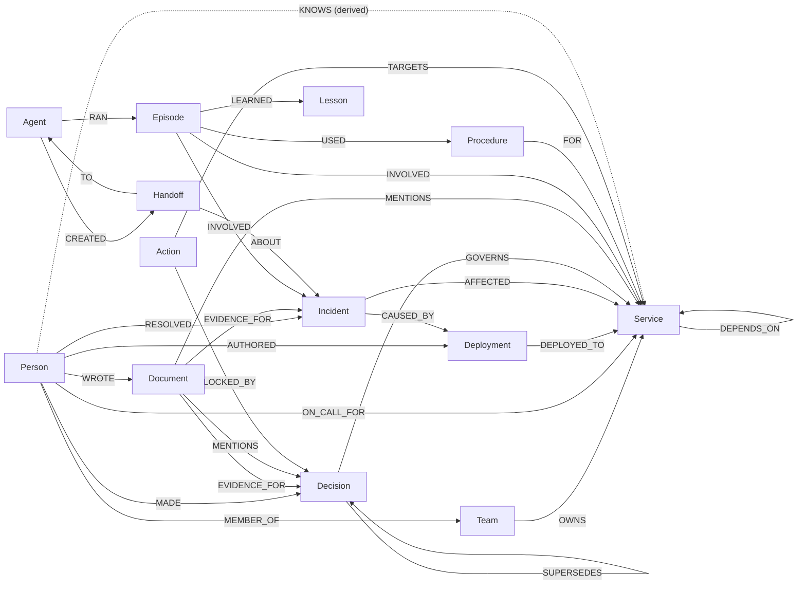
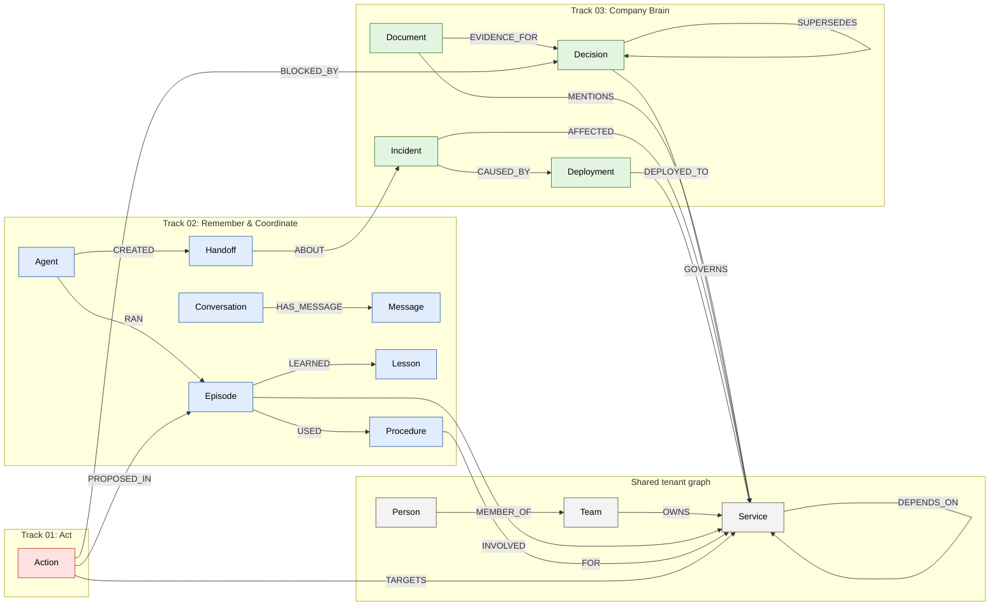

# Triveni graph model (pre-event design note)

Status: **accepted Oct 12** (all Section 8 decisions approved). Written as a pre-event note (allowed under Rule 8). This note becomes `backend/app/graph/schema.py` at kickoff.
Source of truth: MVP.md Section 3. This note refines it. Changes to MVP.md are marked **[Δ]**.

## 0. FalkorDB facts this model depends on (checked on docs.falkordb.com, Oct 12)

| Fact | Source page | Consequence |
|---|---|---|
| Maps **cannot** be property values; arrays of scalars can; `null` cannot be stored | /datatypes | `Handoff.payload`, `Action.args` are JSON strings. `Decision.forbids`, `Procedure.steps` are string arrays. "Current" edge = `valid_to` property absent, so `r.valid_to IS NULL` still works |
| `algo.pageRank(label, relType)`: **one** label, **one** rel type | /algorithms/pagerank | `critical_services` = `algo.pageRank('Service','DEPENDS_ON')` |
| `algo.betweenness({nodeLabels, relationshipTypes, samplingSize, samplingSeed})`; default sampling is 32 random sources and a time-based seed | /algorithms/betweenness-centrality | Must pass `samplingSize >= node count` and a fixed `samplingSeed`, or ground truth won't be reproducible. **Direction handling is undocumented: test it on Day 1** |
| `algo.WCC({nodeLabels, relationshipTypes})` yields `node, componentId`; isolated nodes get their own component; ids are not contiguous | /algorithms/wcc | Orphans = singleton components |
| Range index: `CREATE INDEX FOR (p:Person) ON (p.age)`; edges: `CREATE INDEX FOR ()-[f:FOLLOW]-() ON (f.created_at)` | /cypher/indexing/range-index | Index `id` on every label and `name` on Service/Person/Team |
| Algorithms take labels/types only, **no property filters** | (implied by all signatures) | **Key problem:** history edges (`valid_to` set) would be counted by algorithms. See Section 4 |

Still to check before coding: `algo.SPpaths` vs `SPpath` naming (the docs disagree), and Cypher `shortestPath()` syntax.

## 1. Modelling principles

1. **Four edge categories**, each with a fixed property contract:
   - **State** (facts that can change): `valid_from`, `valid_to` (absent = current), `source_doc`. Never deleted; superseded by setting `valid_to`.
   - **Event** (things that happened; immutable): `source_doc`, `ts` where useful.
   - **System** (written by agents: memory, coordination, actions): `ts`, no `source_doc`.
   - **Derived** (projection for algorithms, rebuilt from current State/Event edges): `derived: true`, `weight`. Safe to delete and rebuild, because they hold no history and no facts of their own.
2. **Every seeded or extracted fact has a source document.** The seed also emits "registry" Documents (service catalog, org chart, on-call schedule) so even baseline facts are cited. This keeps "answers with sources" true for everything.
3. **Stable, readable ids**, prefixed by kind and unique per tenant: `svc:payments-api`, `team:ledger`, `per:priya-nair`, `dep:payments-api@2.14.0`, `inc:0042`, `adr:019`, `doc:pm-0042`, `ep:0001`. MERGE always on `id`.
4. **Time** = ISO-8601 UTC strings, `2026-09-12T08:30:00Z`. They are readable in the Browser and sort correctly as strings.
5. **"Current decision"** is derived from the graph, not stored: an accepted Decision with no incoming `SUPERSEDES`. `status` is kept for display only.

## 2. Nodes

| Label | Properties | Notes |
|---|---|---|
| Person | id, name, role | |
| Team | id, name | |
| Service | id, name, tier (1–3), lang | |
| Deployment | id, version, ts, status (succeeded/failed/rolled_back) | |
| Incident | id, title, severity (SEV1–3), ts_open, ts_close, summary | |
| Decision | id, title, ts, status (proposed/accepted/superseded), rationale, **forbids [Δ]** (string[], action kinds) | `forbids` drives the blocked action in scenario 2 |
| Document | id, title, kind (runbook/postmortem/adr/ticket/chat/**registry [Δ]**), text, ts, source | `source` = file path under `data/raw/` |
| Agent | id, name, role (triage/remediation) | |
| Conversation | id, user_id, started_ts | |
| Message | id, role (user/assistant/tool), text, ts, **seq [Δ]** | `seq` makes ordering trivial; `NEXT` kept for the traversal story |
| Episode | id, ts, question, outcome (resolved/escalated/abandoned) | |
| Lesson | id, text, confidence (0–1), **last_reinforced [Δ]** | for decay (P1) |
| Procedure | id, name, steps (string[]), success_count, fail_count | |
| Handoff | id, ts, status (open/claimed/done), payload (JSON string), **claimed_by [Δ]** | atomic claim writes status + claimed_by in one statement |
| Action | id, kind (create_ticket/notify_owner/change_retry_policy), status (proposed/approved/rejected/**blocked [Δ]**/executed), ts, args (JSON string) | |

## 3. Edges

| Edge | From → To | Category | Used by |
|---|---|---|---|
| MEMBER_OF | Person → Team | State | owner_of, who_knows |
| OWNS | Team → Service | State | owner_of, scenario 7 |
| ON_CALL_FOR | Person → Service | State | scenario 1, 3 (why_not) |
| DEPENDS_ON | Service → Service | State (see 4.3) | blast_radius, PageRank |
| AUTHORED | Person → Deployment | Event | scenario 1, expertise |
| DEPLOYED_TO | Deployment → Service | Event | |
| AFFECTED | Incident → Service | Event | similar_incidents |
| CAUSED_BY | Incident → Deployment | Event | scenario 1 |
| RESOLVED | Person → Incident | Event | expertise |
| MADE | Person → Decision | Event | decision_trail |
| GOVERNS | Decision → Service | Event | decision_trail, action gate |
| SUPERSEDES | Decision → Decision | Event | decision_trail |
| EVIDENCE_FOR | Document → Incident \| Decision | Event | sources |
| MENTIONS | Document → Person \| Service \| Incident \| **Decision [Δ]** | Event | stale-runbook detection (doc mentions a superseded Decision) |
| **WROTE [Δ]** | Person → Document | Event | who_knows (authorship is expertise) |
| HAS_MESSAGE | Conversation → Message | System | load_history |
| NEXT | Message → Message | System | load_history |
| WITH | Conversation → Agent | System | |
| RAN | Agent → Episode | System | |
| INVOLVED | Episode → Service \| Incident \| Person | System | recall (shared-entity hop) |
| LEARNED | Episode → Lesson | System | |
| USED | Episode → Procedure | System | |
| FOR | Procedure → Service | System | |
| CREATED | Agent → Handoff | System | |
| TO | Handoff → Agent | System | |
| ABOUT | Handoff → Incident | System | |
| PROPOSED_IN | Action → Episode | System | |
| TARGETS | Action → Service \| Person | System | |
| APPROVED | Person → Action | System | |
| **BLOCKED_BY [Δ]** | Action → Decision | System | the UI shows why an action was refused, as a path |
| **KNOWS [Δ]** | Person → Service | Derived | betweenness, who_knows ranking |
| **KNOWN_BY [Δ]** | Service → Person | Derived | betweenness (makes paths go both ways) |
| **RESPONSIBLE_FOR [Δ]** | Team \| Person → Service | Derived | WCC orphans |

## 4. The history-vs-algorithms problem (and the fix)

The algorithm procedures can filter by label and type but **not** by `valid_to`. After scenario 7, `team:ledger -OWNS-> svc:billing-batch` still exists, with `valid_to` set. Any algorithm over `OWNS` would treat Ledger as still connected to billing-batch.

**Fix: a small Derived projection layer**, rebuilt by one function `refresh_projections(tenant)` after the seed and after every ingest. It is built only from current State edges and from Event edges. Algorithms run only on Derived edges or on types guaranteed to be current-only.

### 4.1 Expertise: KNOWS / KNOWN_BY (for `key_people`, `who_knows`)
`KNOWS.weight` per (person, service) =
3 × RESOLVED an incident AFFECTING it
+ 2 × AUTHORED a deployment DEPLOYED_TO it
+ 2 × MADE a decision GOVERNING it
+ 1 × WROTE a document MENTIONING it
+ 1 × currently ON_CALL_FOR it.

Each `KNOWS` is paired with a `KNOWN_BY` in the reverse direction. Then
`CALL algo.betweenness({nodeLabels:['Person','Service'], relationshipTypes:['KNOWS','KNOWN_BY'], samplingSize:$n, samplingSeed:42})`
gives the same result whether or not the procedure respects direction, so the open question in Section 0 stops mattering. Single points of knowledge = top-scoring Persons. Provenance: the path shows Service → Person → Service, and the evidence edges explain each KNOWS.

### 4.2 Responsibility: RESPONSIBLE_FOR (for `find_orphans`)
Rebuilt from current `OWNS` (Team → Service) and current `ON_CALL_FOR` (Person → Service).
`CALL algo.WCC({nodeLabels:['Team','Person','Service'], relationshipTypes:['RESPONSIBLE_FOR']})`. A Service alone in its component is an orphan.

### 4.3 DEPENDS_ON
It carries State properties for uniformity, but **no scenario ends a dependency**, so `algo.pageRank('Service','DEPENDS_ON')` is correct. Known limitation for the README: if dependencies ever become temporal, PageRank moves to a derived `DEPENDS_ON_NOW` projection like the ones above.

Rule for `docs/queries.md`: every algorithm call notes which projection it reads and when that projection was last refreshed.

## 5. Planted needles (tenant `acme`)

| # | Needle | Ground truth |
|---|---|---|
| 1 | `checkout-web → cart-api → orders-api → payments-api` (DEPENDS_ON chain), plus `invoice-svc → payments-api` and `refund-worker → invoice-svc`. `team:payments` OWNS payments-api; `per:arjun-mehta` ON_CALL_FOR it. `dep:payments-api@2.14.0` AUTHORED by `per:kavya-rao`, latest by ts. `inc:0042` CAUSED_BY that deployment, AFFECTED payments-api, RESOLVED by `per:priya-nair`; `doc:pm-0042` EVIDENCE_FOR inc:0042 | blast radius ≤3 = {cart-api, orders-api, checkout-web, invoice-svc, refund-worker}; page = arjun-mehta; last deploy = 2.14.0 by kavya-rao; prior incident = inc:0042; source = pm-0042 |
| 2 | `adr:019` SUPERSEDES `adr:007`; both GOVERN orders-api; adr:019 `forbids:['change_retry_policy']`. `doc:rb-orders-retry` (runbook, ts before adr:019) MENTIONS adr:007 | trail = [adr:019 → adr:007] with sources; stale = {rb-orders-retry}; action `change_retry_policy` on orders-api is **blocked** by adr:019 |
| 3 | `team:ledger` OWNS billing-batch; **no** ON_CALL_FOR to it. `svc:legacy-fax-gateway` and `svc:pdf-renderer-v1` have no owner and no on-call | why_not(on-call, billing-batch) = absent, with the checked pattern returned; orphans = {legacy-fax-gateway, pdf-renderer-v1} |
| 4 | `per:priya-nair` and `per:dev-malhotra` are the only people with KNOWS edges into two service clusters each (payments↔ledger, search↔platform) | top-2 betweenness Persons = {priya-nair, dev-malhotra}. Cross-checked with networkx in a test |
| 5 | `ep:0001` (RAN by triage agent) INVOLVED inc:0042 + payments-api; LEARNED `lesson:pool-exhaustion` (0.8); USED `proc:rollback-payments` (success 2, fail 0) FOR payments-api. `conv:0001` with 4 Messages | a new payments-api incident recalls ep:0001 via payments-api; procedure = rollback-payments |
| 6 | `agent:triage`, `agent:remediation`; no Handoffs seeded | (created live) |
| 7 | `team:ledger` OWNS billing-batch, `valid_from` 2026-03-01, source `doc:service-catalog`; `team:atlas` exists, with members | before: owner = ledger; after ingesting `chat:billing-move`: owner = atlas, and the ledger edge has `valid_to` set; both sources returned |
| 7b | `adr:023` SUPERSEDES `adr:011`; both GOVERN billing-batch. `doc:rb-billing-rerun` (runbook) MENTIONS adr:011 | after scenario 7, stale runbooks for Atlas-owned services = {rb-billing-rerun} (eval C5) |
| 8 | tenant `beta` has its own `svc:payments-api`, owned by `team:core` with different people (no name overlaps with acme except service names) | beta answer ≠ acme answer; an acme query never returns any beta-only id |

Names are synthetic. The service-name overlap in tenant beta is deliberate, so an isolation leak would show up.

## 6. Size budget (acme)

Nodes: 40 Service, 8 Team, 60 Person, 60 Deployment, 30 Incident, 17 Decision, 60 Document, 2 Agent, about 10 memory (Conversation/Message/Episode/Lesson/Procedure) ≈ **285**.
Edges: DEPENDS_ON 90, MEMBER_OF 60, OWNS 40, ON_CALL_FOR 35, AUTHORED 60, DEPLOYED_TO 60, AFFECTED 45, CAUSED_BY 20, RESOLVED 40, MADE 15, GOVERNS 25, SUPERSEDES 5, EVIDENCE_FOR 50, MENTIONS ~300, WROTE 60, memory ~15 ≈ 920 fact/system edges, plus about 450 derived (KNOWS, KNOWN_BY, RESPONSIBLE_FOR) ≈ **1.4k**.
Beta: 12 Service, 3 Team, 20 Person, plus ~45 others ≈ 80.

## 7. Day-1 checks in FalkorDB Browser (before building on them)

1. `SET r.valid_to = null` on an edge: does it remove the property or raise an error? (The docs only say null can't be stored.)
2. Betweenness direction on a 3-node directed chain (curiosity only; 4.1 makes us independent of the answer).
3. `algo.SPpaths` exact name and signature; Cypher `shortestPath()` in a MATCH.
4. With `nodeLabels` set, does WCC include isolated nodes of those labels? (The doc example says yes for the all-labels case.)
5. Variable-length match with an edge-property filter: `MATCH p=(a)-[:DEPENDS_ON*1..3]->(b) WHERE all(r IN relationships(p) WHERE r.valid_to IS NULL)`.

## 8. Decisions needed

- [x] Accept the four edge categories and the Derived projection layer (Section 4)?
- [x] Accept the additions to MVP.md: Decision.forbids, Document kind `registry`, MENTIONS→Decision, WROTE, BLOCKED_BY, Message.seq, Lesson.last_reinforced, Handoff.claimed_by, Action status `blocked`?
- [x] ISO strings for time (vs epoch ints)?
- [x] networkx as a dev-only dependency for cross-checking betweenness ground truth?

## 9. Pillar view (for README and video)

Each label is colored by the track that owns it. Shared org/knowledge nodes are the confluence.

Story for the video: every pillar's subgraph has edges into `Service`, so the three tracks meet on the same nodes. That's the "confluence".
